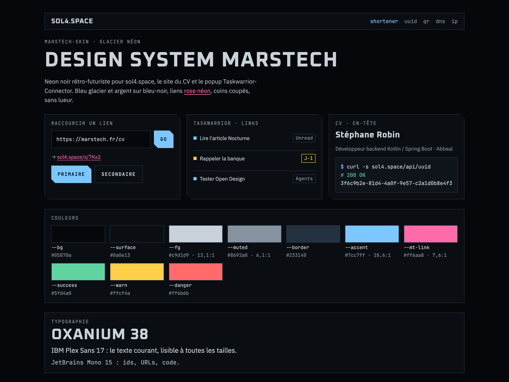
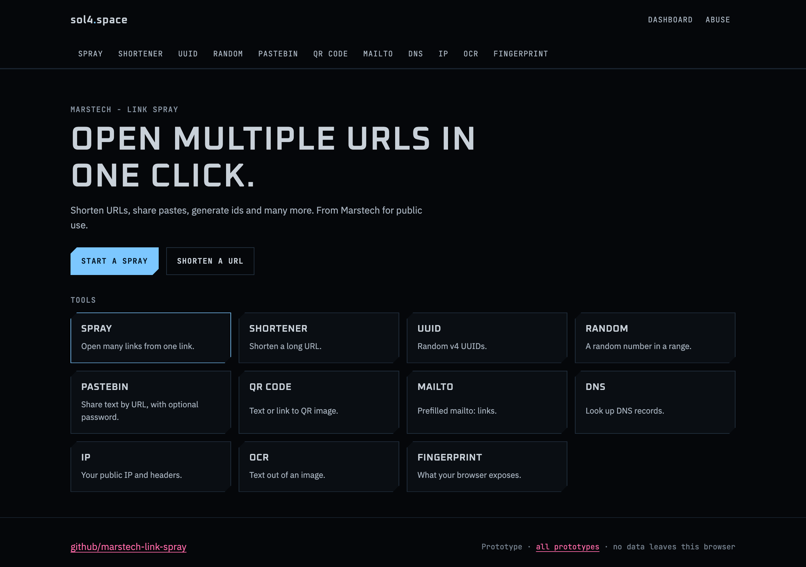
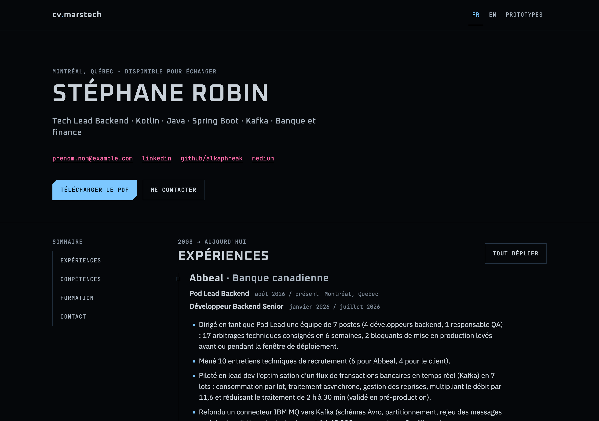
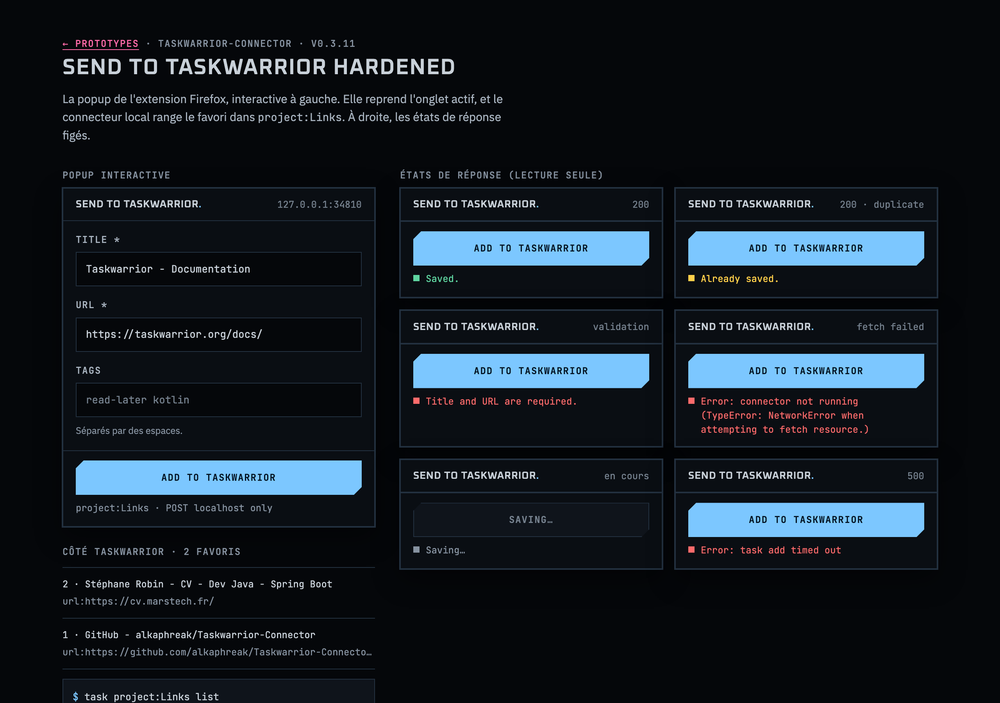

# MarsTech-Skin

The MarsTech design system: one visual identity shared by
[sol4.space](https://sol4.space) ([marstech-link-spray](https://github.com/alkaphreak/marstech-link-spray)),
MarsTech-CV-Website and the [Taskwarrior-Connector](https://github.com/alkaphreak/Taskwarrior-Connector)
Firefox popup.

Direction "Glacier néon": retro-futurist neon noir, ice blue and silver on blue-black, neon pink links,
clipped corners, no glow. Inspired by Ghost in the Shell, Blade Runner and the HUD screens of the Alien films.



The specimen is `docs/preview/specimen.html`. To refresh the image after a token change:

```bash
"/Applications/Google Chrome.app/Contents/MacOS/Google Chrome" --headless=new --hide-scrollbars \
  --virtual-time-budget=8000 --force-device-scale-factor=2 --window-size=1280,960 \
  --screenshot="$PWD/docs/images/overview.png" "file://$PWD/docs/preview/specimen.html"
```

## Prototypes

`prototypes/` holds the three products rendered with this skin, built in Open Design and validated on
2026-11-03 (MARSTECH-851). Open `prototypes/index.html` in a browser; the CV uses placeholder contact
details and client names.

| sol4.space | CV | Taskwarrior popup |
|------------|----|-------------------|
|  |  |  |

## Files

| File           | Role                                                                  |
|----------------|-----------------------------------------------------------------------|
| `tokens.css`   | Source of truth for values: the 56 tokens of the Open Design schema   |
| `marstech.css` | Brand extensions and base components: link color, clipped corners, labels, header, buttons, fields, panels, badges, toast |
| `DESIGN.md`    | The rules: color roles, typography, components, anti-patterns         |
| `fonts.css`    | `@font-face` rules for the self-hosted woff2 files in `fonts/` (OFL)   |
| `fonts/`       | Oxanium, IBM Plex Sans, JetBrains Mono woff2 (latin), each with its `OFL.txt` |
| `prototypes/`  | sol4.space, CV and popup prototypes (`od-layout.css`: Open Design layout helpers) |

## Use it in a project

Copy or vendor the stylesheets (and `fonts/` next to `fonts.css`), load them in this order, then style
components through the tokens:

```html
<link rel="stylesheet" href="fonts.css">
<link rel="stylesheet" href="tokens.css">
<link rel="stylesheet" href="marstech.css">
```

```css
.card { background: var(--surface); border: 1px solid var(--border); }
```

Fonts (Oxanium, IBM Plex Sans, JetBrains Mono, all under the SIL Open Font License) must be served by
each project itself: no Google Fonts call at runtime. `fonts.css` and `fonts/` do that; keep each
`OFL.txt` next to its font when copying.

## Open Design

The layout follows Open Design's design-system format (`DESIGN.md` + `tokens.css`), so the folder can be
imported as a local design system and Open Design derives `design-tokens.json`, a Tailwind v4 theme and
a component inventory from it.

## License

Apache-2.0, see `LICENSE`.
